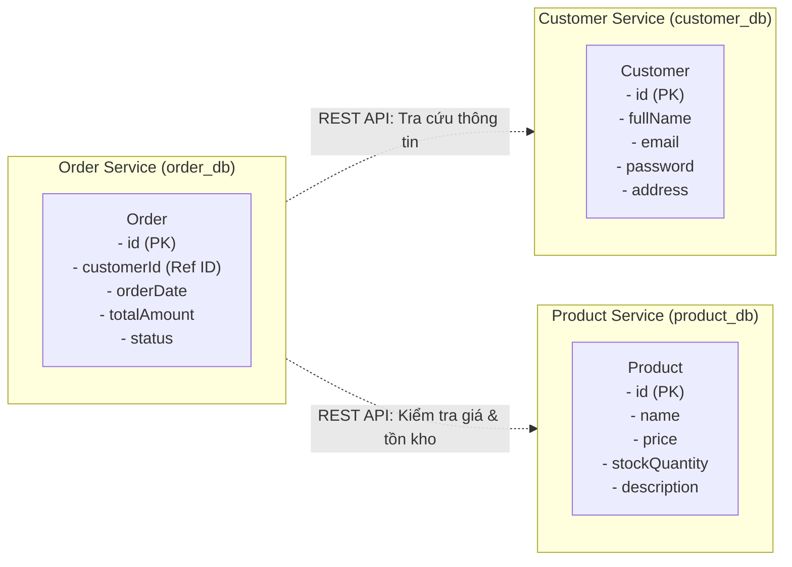

# THIẾT KẾ 3 SERVICE TMĐT (TÓM TẮT TRỌNG TÂM)

## 1. PHÂN CHIA SERVICE & THỰC THỂ

| Service | Database riêng | Thực thể & Thuộc tính |
| :--- | :--- | :--- |
| **Customer Service** | `customer_db` | `Customer` (`id`, `fullName`, `email`, `password`, `address`) |
| **Product Service** | `product_db` | `Product` (`id`, `name`, `price`, `stockQuantity`, `description`) |
| **Order Service** | `order_db` | `Order` (`id`, `customerId`, `orderDate`, `totalAmount`, `status`) |

> **Quy tắc**: Mỗi service sở hữu database riêng, không dùng chung DB và giao tiếp qua REST API (OpenFeign), không gọi trực tiếp code của nhau.

---

## 2. SƠ ĐỒ THỰC THỂ VÀ KIẾN TRÚC

---

## 3. TẠI SAO ORDER CHỈ NÊN LƯU `customerId` MÀ KHÔNG LƯU CẢ ĐỐI TƯỢNG `Customer`?

1. **Khớp nối lỏng (Loose Coupling)**:
   * Giúp `Order Service` độc lập hoàn toàn với `Customer Service`. Mọi thay đổi về cấu trúc hay logic của `Customer` không làm ảnh hưởng đến mã nguồn và database của `Order`.

2. **Dữ liệu nhất quán & Nguồn sự thật duy nhất (Single Source of Truth)**:
   * `Customer Service` là nơi duy nhất quản lý thông tin khách hàng.
   * Nếu lưu cả đối tượng `Customer` trong `Order`, khi khách hàng cập nhật email, tên, đổi mật khẩu... dữ liệu ở `Order` sẽ bị lệch (sai/lỗi thời), hoặc phải tốn chi phí cập nhật lại toàn bộ đơn hàng cũ.

3. **Bảo mật dữ liệu (Security)**:
   * Đối tượng `Customer` chứa thông tin nhạy cảm (như `password`). `Order Service` không có lý do nghiệp vụ nào để biết hoặc lưu trữ các thông tin này.

4. **Tối ưu lưu trữ & Hiệu năng (Performance & Storage)**:
   * Chỉ lưu một trường `customerId` (kiểu số) giúp bảng `Order` gọn nhẹ, đánh index nhanh, tránh dư thừa dữ liệu khi một khách hàng có hàng trăm đơn hàng.
